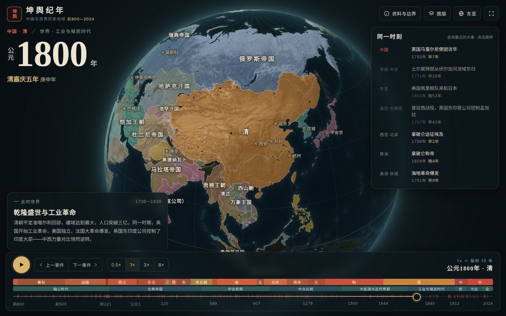

# 坤舆纪年

以中国为主线的世界历史地球仪。转动地球、拖动时间轴，看公元前800年到2024年之间，同一时刻的世界是什么样子。

**在线体验：** https://wanglu2016.github.io/kunyu-jinian/
**使用讲解视频（3分钟）：** https://wanglu2016.github.io/kunyu-jinian/video.html



## 能做什么

- **转动地球：** 鼠标拖动或手指滑动旋转，滚轮或双指捏合缩放。
- **穿越年代：** 拖动底部时间轴，或点播放键让历史流动（每秒10年，最快每秒80年）；“上一事件 / 下一事件”在中国历史大事之间跳转。
- **中国纪年：** 每一年都显示当时的年号或王公纪年和干支，分裂时期并列显示，例如“魏景元四年 · 蜀景耀六年→炎兴元年 · 吴永安六年”。
- **同一时刻：** 同一段时间里世界七个区域各自发生的大事，点击即可跳到那一年。
- **此地归属：** 点击地球上任意一点，列出这里自前800年以来先后属于哪些政权。
- **城市古称：** 约100座城市的名称随年代变化，如长安 → 京兆 → 西安。

## 下载

- **离线版网页（约 5 MB）：** [kunyu-jinian-site.zip](https://github.com/wanglu2016/kunyu-jinian/raw/main/download/kunyu-jinian-site.zip)。解压后双击 `index.html` 即可使用，不需要联网或安装任何软件。
- **讲解视频（41 MB）：** [坤舆纪年_使用讲解.mp4](https://github.com/wanglu2016/kunyu-jinian/raw/main/video/kunyu-jinian-guide.mp4)，也可以在[视频页](https://wanglu2016.github.io/kunyu-jinian/video.html)点“下载视频”。
- **全部源代码：** 页面右上角绿色的 **Code → Download ZIP**（含视频，约 45 MB；解压后同样可以双击 `index.html` 离线使用）。

需要较新的 Chrome、Edge、Safari 或 Firefox（支持 WebGL2）。手机也可以使用。

## 读图须知

地图上的色块是“当时的势力范围”，不是精确国界。前现代国家大多没有今天意义上的边界线，游牧政权、羁縻和朝贡关系也无法用一条线表示，所以1600年以前的边界画成晕开的软线。

- 疆域来自国外学术数据集 Cliopatria。它对部分地区的处理与中国学界通行看法不同，例如直到1794年才把西藏画入清朝疆域，1949年后把台湾单独绘出；点击相关地区时页面会显示说明。
- **1912年以后的边界未经中国地图审核，不能作为国界依据。**
- 数据集只收录有文字记载、一般面积在5000平方公里以上、存续50年以上的政权；夏朝等传说时代政权不在其中。非洲、美洲、东南亚的资料明显少于欧亚大陆。
- 1521个政权的中文译名、约280件大事、37段时代解说和城市古称由 AI（Claude）编写，可能有错漏，欢迎在 Issues 中指出。

## 数据来源与许可

| 内容 | 来源 | 许可 |
|---|---|---|
| 政权疆域 | [Cliopatria](https://github.com/Seshat-Global-History-Databank/cliopatria)（Seshat Global History Databank；Bennett 等，《Scientific Data》2025，[doi:10.1038/s41597-025-04516-9](https://doi.org/10.1038/s41597-025-04516-9)）。本项目截取前800年以后的数据，做了形状简化、同名政权按年代拆分和中文化处理 | CC BY 4.0 |
| 前140年以后的年号 | [china-chronology](https://github.com/e-cloud/china_chronology)（据 CBDB 中国历代人物传记资料库整理） | MIT |
| 底图地形 | NASA Blue Marble 影像（经 three-globe 示例图分发），重新调色 | 公共领域 |
| 海岸、湖泊、河流 | [Natural Earth](https://www.naturalearthdata.com/) | 公共领域 |
| 字体 | Noto Serif SC / Noto Sans SC，按本项目用字裁剪 | SIL OFL 1.1（见 `assets/fonts/OFL.txt`） |

## 项目结构

```
index.html          地球仪页面（单文件，无需构建）
video.html          讲解视频页
download/           离线版压缩包
assets/             数据（data.js、geo.js、textures.js）、字体、图片
video/              讲解视频
tools/              数据处理脚本，见 tools/README.md
```

本地运行：直接双击 `index.html`；或在项目目录运行 `python3 -m http.server`，再打开 http://localhost:8000 。
